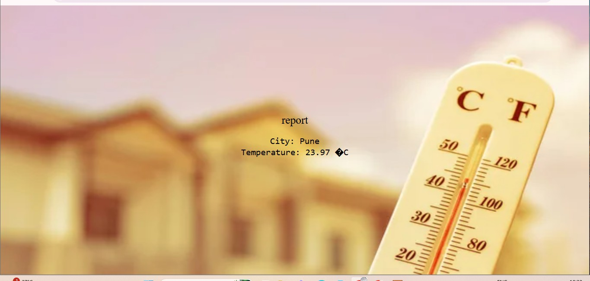

# FlaskReply

A lightweight Flask web app using the Gemini API.

## Screenshot

## Api_Find_Data

Fetches city temperature and other details using an API with a Python backend and HTML, CSS, and PHP frontend[cite: 3].

